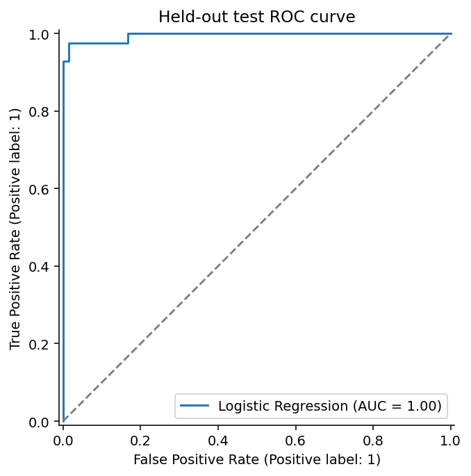
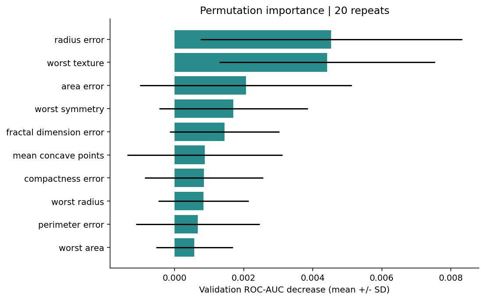

# Predictive Risk Modeling & Explainability

**Wawan Saputra · Statistics & Data Science · 2026**

Compare statistical and tree-based classifiers on image-derived breast-mass measurements, with training-only preprocessing, separate model/threshold selection, and a held-out evaluation. This is an educational classification study; it is not a validated medical decision tool.

[Executive summary](outputs/executive_summary.md) · [Model comparison](outputs/tables/model_comparison.csv) · [Notebooks](notebooks) · [Data attribution](THIRD_PARTY_DATA.md)

## Results at a glance

| Held-out result | Value |
|---|---:|
| Selected model | Logistic Regression |
| Test samples | 114 |
| ROC-AUC | 0.9954 |
| Precision / recall | 1.0000 / 0.9286 |
| F1 | 0.9630 |
| False negatives / false positives | 3 / 0 |
| Brier score | 0.0214 |

Results use a validation-selected threshold of **0.68**. Test precision of 1.00 describes this small sample; it does not imply perfect future precision. No confidence intervals or external validation are claimed.



## Question and dataset

How well can logistic regression and tree-based models distinguish malignant from benign samples, and which measurements does the selected model rely on?

The Wisconsin Diagnostic Breast Cancer dataset contains **569 samples and 30 numerical predictors**. It is loaded locally from scikit-learn; **1=malignant, 0=benign**. Features describe digitized fine-needle aspirate images, so this task does not estimate population screening risk. See [source documentation](data/DATASET.md), [attribution and CC BY 4.0 terms](THIRD_PARTY_DATA.md), and [snapshot checksums](data/snapshot_manifest.json).

## Evaluation design

1. Stratified train/validation/test split: **341 / 114 / 114**, seed 42.
2. Median imputation and scaling are fitted inside each training pipeline and CV fold.
3. Compare four fixed candidate specifications using five-fold stratified CV on training only.
4. Select the model by mean training-CV ROC-AUC; choose its threshold by validation F1.
5. Keep that training fit and threshold fixed for the held-out test.

| model               |   Training CV ROC-AUC |   Fold SD |   Validation ROC-AUC |
|:--------------------|----------------------:|----------:|---------------------:|
| Logistic Regression |                0.9941 |    0.0088 |               0.9957 |
| Gradient Boosting   |                0.9898 |    0.0115 |               0.9928 |
| Random Forest       |                0.9857 |    0.0144 |               0.9908 |
| Decision Tree       |                0.9661 |    0.0227 |               0.9387 |

CV fold standard deviation is descriptive variability, not a confidence interval. Validation results above use the default 0.5 threshold for threshold-dependent metrics; the final threshold is selected afterwards. Full-dataset EDA is descriptive only and does not guide feature selection or tuning.

## Explainability

Permutation importance uses validation data, ROC-AUC and 20 repeats. Partial dependence and calibration provide additional diagnostics. Importance measures model reliance, not a causal effect; correlated measurements can share importance or make partial-dependence combinations unrealistic.



## Run locally

Python **3.11** was tested. From this repository:

```powershell
python -m venv .venv
.\.venv\Scripts\python.exe -m pip install -r requirements-lock.txt
.\.venv\Scripts\python.exe -m src.train
.\.venv\Scripts\python.exe -m unittest discover -s tests -v
```

Linux/macOS: replace `.\.venv\Scripts\python.exe` with `.venv/bin/python`. Direct analysis dependencies are pinned; this is not a complete transitive environment lock. Install JupyterLab and ipykernel separately to open the four notebooks. Model files are generated locally and ignored by Git.

## Limitations and Future Work

Small historical single-source data; no external validation, uncertainty intervals, fairness audit or patient-level grouping identifiers. F1 optimization does not encode clinical error costs. Future work: repeated/nested evaluation, external samples, performance uncertainty and domain-informed thresholds. The result is a reproducible modeling demonstration, not evidence of clinical utility.

## Repository guide

`src/` modular analysis · `notebooks/` EDA/preprocessing/modeling/explainability · `data/` attributed snapshots · `outputs/figures/` plots · `outputs/tables/` metrics and predictions · `tests/` integrity checks.

The [executive summary](outputs/executive_summary.md) includes two CV-ready bullets based on the actual experiment.
